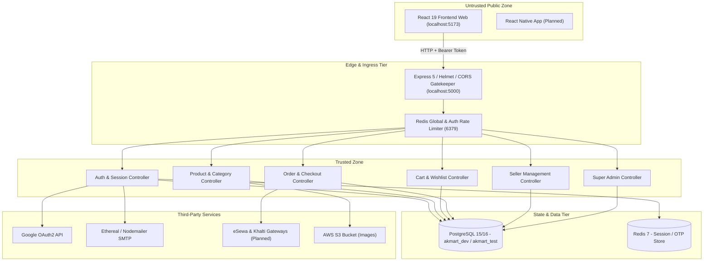

# Phase 1: Discovery, Inventory, Risk Analysis, and Test Strategy
**Project:** AkMart Multi-Vendor E-Commerce Platform  
**Auditor:** Principal QA Architect / Senior SDET  
**Date:** 2026-10-26  
**Active Branch:** `qa-testing`  

---

## 1A. Master Inventory Ledger (Derived from Real Code)

### 1. File Structure & Component Purpose
| Path | Layer | Responsibility / Purpose |
| :--- | :--- | :--- |
| `Backend/src/server.ts` | Backend Runtime | Initializes HTTP server on port 5000, exports instance, logs health status |
| `Backend/src/app.ts` | Express Core | Configures security headers (Helmet), CORS, JSON parsers, rate limiters, mount routes, health check, global error handler |
| `Backend/src/config/env.ts` | Config / Security | Zod validation of all environment variables (DB, Redis, JWT, CORS, SMTP, AWS) |
| `Backend/src/middlewares/auth.middleware.ts` | Security / RBAC | JWT access token verification (`requireAuth`), DB user active check, role-based authorization (`requireRole`) |
| `Backend/src/middlewares/rateLimiter.ts` | Resilience / DoS | Redis-backed global rate limiter (1000 req/min) and auth rate limiter (5 req/min) |
| `Backend/src/middlewares/errorHandler.ts` | Resilience / Error | Centralized error formatting, AppError serialization, hides internal stack traces |
| `Backend/src/middlewares/validateRequest.ts` | Input Validation | Express middleware wrapper for Zod schema validation on body, query, and params |
| `Backend/src/routes/auth.routes.ts` | API Routing | Auth routes (register, verify, login, google, refresh, logout, forgot/reset password, me) |
| `Backend/src/routes/session.routes.ts` | API Routing | Multi-device session inspection and revocation |
| `Backend/src/routes/product.routes.ts` | API Routing | Catalog browsing, detail by slug, product creation, submission, review submission |
| `Backend/src/routes/category.routes.ts` | API Routing | Public category tree, category filters, brands |
| `Backend/src/routes/cart.routes.ts` | API Routing | Consumer cart retrieval, add/update/remove items, clear cart |
| `Backend/src/routes/wishlist.routes.ts` | API Routing | Wishlist fetch, add item, remove item, clear wishlist |
| `Backend/src/routes/order.routes.ts` | API Routing | Checkout, order history, order cancellation, address management |
| `Backend/src/routes/coupon.routes.ts` | API Routing | Active coupon discovery, promo code validation |
| `Backend/src/routes/seller.routes.ts` | API Routing | Seller profile onboarding, listing management, order status update |
| `Backend/src/routes/admin.routes.ts` | API Routing | Admin dashboard, product review queue, seller approval, categories, brands |
| `Backend/prisma/schema.prisma` | Data Tier | Complete PostgreSQL database schema with 23 models, 6 enums, and foreign key relations |
| `Frontend/src/App.jsx` | UI Entry | Top-level layout container with Toast notifications, ScrollToTop, SearchOverlay, and Router |
| `Frontend/src/routes/AppRoutes.tsx` | UI Routing | Route definitions with lazy loading, role-based protection (`ProtectedRoute`), and layouts |
| `Frontend/src/routes/ProtectedRoute.tsx` | UI Auth Guard | Enforces authentication and role verification before rendering protected views |
| `Frontend/src/store/authStore.ts` | UI State | Zustand persistent auth store (user DTO, access token memory persistence, logout) |
| `Frontend/src/context/ShopContext.tsx` | UI State | Central state context for catalog data, cart items, search filters, currency formatting |
| `Frontend/src/api/client.ts` | UI Network | Axios HTTP client configured with baseURL, interceptors for JWT injection, and refresh token retry |

---

### 2. Complete API Endpoints Inventory
| Method | Path | Auth Required | Roles Permitted | Request Payload | Response Schema | Source Location |
| :--- | :--- | :---: | :---: | :--- | :--- | :--- |
| `GET` | `/health` | No | Any | None | `{ status: "ok", message: string }` | [CODE: Backend/src/app.ts:73](file:///c:/akmart-ecommerce/Backend/src/app.ts#L73) |
| `POST` | `/api/v1/auth/register` | No | Any | `{ fullName, email?, phoneNumber?, password, role? }` | `{ success: true, message: string }` | [CODE: Backend/src/routes/auth.routes.ts:11](file:///c:/akmart-ecommerce/Backend/src/routes/auth.routes.ts#L11) |
| `GET` | `/api/v1/auth/cancel-registration` | No | Any | Query: `?email=...` | `{ success: true, message: string }` | [CODE: Backend/src/routes/auth.routes.ts:12](file:///c:/akmart-ecommerce/Backend/src/routes/auth.routes.ts#L12) |
| `POST` | `/api/v1/auth/verify-account` | No | Any | `{ identifier, token }` | `{ success: true, message: string, data: { user, accessToken } }` | [CODE: Backend/src/routes/auth.routes.ts:13](file:///c:/akmart-ecommerce/Backend/src/routes/auth.routes.ts#L13) |
| `POST` | `/api/v1/auth/resend-otp` | No | Any | `{ identifier }` | `{ success: true, message: string }` | [CODE: Backend/src/routes/auth.routes.ts:14](file:///c:/akmart-ecommerce/Backend/src/routes/auth.routes.ts#L14) |
| `DELETE`| `/api/v1/auth/account` | Yes | Any | None | `{ success: true, message: string }` | [CODE: Backend/src/routes/auth.routes.ts:15](file:///c:/akmart-ecommerce/Backend/src/routes/auth.routes.ts#L15) |
| `GET` | `/api/v1/auth/me` | Yes | Any | None | `{ success: true, data: UserDTO }` | [CODE: Backend/src/routes/auth.routes.ts:18](file:///c:/akmart-ecommerce/Backend/src/routes/auth.routes.ts#L18) |
| `PUT` | `/api/v1/auth/me` | Yes | Any | `{ fullName?, avatarUrl? }` | `{ success: true, data: UserDTO }` | [CODE: Backend/src/routes/auth.routes.ts:19](file:///c:/akmart-ecommerce/Backend/src/routes/auth.routes.ts#L19) |
| `POST` | `/api/v1/auth/login` | No | Any | `{ email?, phoneNumber?, password }` | `{ success: true, message: string, data: { user, accessToken } }` | [CODE: Backend/src/routes/auth.routes.ts:20](file:///c:/akmart-ecommerce/Backend/src/routes/auth.routes.ts#L20) |
| `POST` | `/api/v1/auth/google` | No | Any | `{ idToken, deviceInfo? }` | `{ success: true, data: { user, accessToken } }` | [CODE: Backend/src/routes/auth.routes.ts:21](file:///c:/akmart-ecommerce/Backend/src/routes/auth.routes.ts#L21) |
| `POST` | `/api/v1/auth/refresh-token` | No | Any | Cookie: `refreshToken` OR Body: `{ refreshToken }` | `{ success: true, data: { accessToken } }` | [CODE: Backend/src/routes/auth.routes.ts:22](file:///c:/akmart-ecommerce/Backend/src/routes/auth.routes.ts#L22) |
| `POST` | `/api/v1/auth/logout` | No | Any | Cookie / Body refresh token | `{ success: true, message: string }` | [CODE: Backend/src/routes/auth.routes.ts:23](file:///c:/akmart-ecommerce/Backend/src/routes/auth.routes.ts#L23) |
| `POST` | `/api/v1/auth/forgot-password`| No | Any | `{ email?, phoneNumber? }` | `{ success: true, message: string }` | [CODE: Backend/src/routes/auth.routes.ts:26](file:///c:/akmart-ecommerce/Backend/src/routes/auth.routes.ts#L26) |
| `POST` | `/api/v1/auth/reset-password` | No | Any | `{ token, newPassword }` | `{ success: true, message: string }` | [CODE: Backend/src/routes/auth.routes.ts:27](file:///c:/akmart-ecommerce/Backend/src/routes/auth.routes.ts#L27) |
| `GET` | `/api/v1/sessions` | Yes | Any | None | `{ success: true, data: SessionDTO[] }` | [CODE: Backend/src/routes/session.routes.ts:10](file:///c:/akmart-ecommerce/Backend/src/routes/session.routes.ts#L10) |
| `DELETE`| `/api/v1/sessions` | Yes | Any | None | `{ success: true, message: string }` | [CODE: Backend/src/routes/session.routes.ts:11](file:///c:/akmart-ecommerce/Backend/src/routes/session.routes.ts#L11) |
| `DELETE`| `/api/v1/sessions/:sessionId` | Yes | Any | Param: `sessionId` | `{ success: true, message: string }` | [CODE: Backend/src/routes/session.routes.ts:12](file:///c:/akmart-ecommerce/Backend/src/routes/session.routes.ts#L12) |
| `GET` | `/api/v1/categories/tree` | No | Any | None | `{ success: true, data: CategoryTree[] }` | [CODE: Backend/src/routes/category.routes.ts:6](file:///c:/akmart-ecommerce/Backend/src/routes/category.routes.ts#L6) |
| `GET` | `/api/v1/categories/:slug/filters` | No | Any | Param: `slug` | `{ success: true, data: AttributeConfig[] }` | [CODE: Backend/src/routes/category.routes.ts:7](file:///c:/akmart-ecommerce/Backend/src/routes/category.routes.ts#L7) |
| `GET` | `/api/v1/categories/brands` | No | Any | None | `{ success: true, data: Brand[] }` | [CODE: Backend/src/routes/category.routes.ts:8](file:///c:/akmart-ecommerce/Backend/src/routes/category.routes.ts#L8) |
| `GET` | `/api/v1/products` | Optional | Any | Query: `?category=&brand=&search=&page=&limit=` | `{ success: true, data: { products, total, page } }` | [CODE: Backend/src/routes/product.routes.ts:30](file:///c:/akmart-ecommerce/Backend/src/routes/product.routes.ts#L30) |
| `GET` | `/api/v1/products/slug/:slug` | No | Any | Param: `slug` | `{ success: true, data: ProductDetail }` | [CODE: Backend/src/routes/product.routes.ts:31](file:///c:/akmart-ecommerce/Backend/src/routes/product.routes.ts#L31) |
| `GET` | `/api/v1/products/:id/reviews` | No | Any | Param: `id`, Query: `?page=&limit=` | `{ success: true, data: { reviews, total } }` | [CODE: Backend/src/routes/product.routes.ts:32](file:///c:/akmart-ecommerce/Backend/src/routes/product.routes.ts#L32) |
| `POST` | `/api/v1/products` | Yes | `ADMIN`, `SELLER` | `{ name, description, categoryId, brandId?, variants }` | `{ success: true, data: Product }` | [CODE: Backend/src/routes/product.routes.ts:35](file:///c:/akmart-ecommerce/Backend/src/routes/product.routes.ts#L35) |
| `PATCH`| `/api/v1/products/:id/submit` | Yes | `ADMIN`, `SELLER` | Param: `id` | `{ success: true, data: Product }` | [CODE: Backend/src/routes/product.routes.ts:36](file:///c:/akmart-ecommerce/Backend/src/routes/product.routes.ts#L36) |
| `PATCH`| `/api/v1/products/:id` | Yes | `ADMIN`, `SELLER` | Param: `id`, Body: partial updates | `{ success: true, data: Product }` | [CODE: Backend/src/routes/product.routes.ts:37](file:///c:/akmart-ecommerce/Backend/src/routes/product.routes.ts#L37) |
| `DELETE`| `/api/v1/products/:id` | Yes | `ADMIN`, `SELLER` | Param: `id` | `{ success: true, message: string }` | [CODE: Backend/src/routes/product.routes.ts:38](file:///c:/akmart-ecommerce/Backend/src/routes/product.routes.ts#L38) |
| `POST` | `/api/v1/products/:id/reviews` | Yes | `CONSUMER` | Param: `id`, Body: `{ rating, title?, body? }` | `{ success: true, data: Review }` | [CODE: Backend/src/routes/product.routes.ts:41](file:///c:/akmart-ecommerce/Backend/src/routes/product.routes.ts#L41) |
| `GET` | `/api/v1/cart` | Yes | `CONSUMER` | None | `{ success: true, data: Cart }` | [CODE: Backend/src/routes/cart.routes.ts:9](file:///c:/akmart-ecommerce/Backend/src/routes/cart.routes.ts#L9) |
| `POST` | `/api/v1/cart/items` | Yes | `CONSUMER` | `{ sellerListingId, variantId, quantity }` | `{ success: true, data: CartItem }` | [CODE: Backend/src/routes/cart.routes.ts:10](file:///c:/akmart-ecommerce/Backend/src/routes/cart.routes.ts#L10) |
| `PATCH`| `/api/v1/cart/items/:id` | Yes | `CONSUMER` | Param: `id`, Body: `{ quantity }` | `{ success: true, data: CartItem }` | [CODE: Backend/src/routes/cart.routes.ts:11](file:///c:/akmart-ecommerce/Backend/src/routes/cart.routes.ts#L11) |
| `DELETE`| `/api/v1/cart/items/:id` | Yes | `CONSUMER` | Param: `id` | `{ success: true, message: string }` | [CODE: Backend/src/routes/cart.routes.ts:12](file:///c:/akmart-ecommerce/Backend/src/routes/cart.routes.ts#L12) |
| `DELETE`| `/api/v1/cart` | Yes | `CONSUMER` | None | `{ success: true, message: string }` | [CODE: Backend/src/routes/cart.routes.ts:13](file:///c:/akmart-ecommerce/Backend/src/routes/cart.routes.ts#L13) |
| `GET` | `/api/v1/wishlist` | Yes | Any authenticated | None | `{ success: true, data: Wishlist }` | [CODE: Backend/src/routes/wishlist.routes.ts:9](file:///c:/akmart-ecommerce/Backend/src/routes/wishlist.routes.ts#L9) |
| `POST` | `/api/v1/wishlist/items` | Yes | Any authenticated | `{ variantId }` | `{ success: true, data: WishlistItem }` | [CODE: Backend/src/routes/wishlist.routes.ts:11](file:///c:/akmart-ecommerce/Backend/src/routes/wishlist.routes.ts#L11) |
| `DELETE`| `/api/v1/wishlist/items/:variantId` | Yes | Any authenticated | Param: `variantId` | `{ success: true, message: string }` | [CODE: Backend/src/routes/wishlist.routes.ts:12](file:///c:/akmart-ecommerce/Backend/src/routes/wishlist.routes.ts#L12) |
| `DELETE`| `/api/v1/wishlist` | Yes | Any authenticated | None | `{ success: true, message: string }` | [CODE: Backend/src/routes/wishlist.routes.ts:10](file:///c:/akmart-ecommerce/Backend/src/routes/wishlist.routes.ts#L10) |
| `POST` | `/api/v1/orders/checkout` | Yes | `CONSUMER` | `{ shippingAddressId, paymentMethod, couponCode? }` | `{ success: true, data: OrderDTO }` | [CODE: Backend/src/routes/order.routes.ts:9](file:///c:/akmart-ecommerce/Backend/src/routes/order.routes.ts#L9) |
| `GET` | `/api/v1/orders` | Yes | `CONSUMER` | None | `{ success: true, data: OrderDTO[] }` | [CODE: Backend/src/routes/order.routes.ts:10](file:///c:/akmart-ecommerce/Backend/src/routes/order.routes.ts#L10) |
| `GET` | `/api/v1/orders/:id` | Yes | `CONSUMER` | Param: `id` | `{ success: true, data: OrderDTO }` | [CODE: Backend/src/routes/order.routes.ts:11](file:///c:/akmart-ecommerce/Backend/src/routes/order.routes.ts#L11) |
| `PATCH`| `/api/v1/orders/:id/cancel` | Yes | `CONSUMER` | Param: `id` | `{ success: true, data: OrderDTO }` | [CODE: Backend/src/routes/order.routes.ts:12](file:///c:/akmart-ecommerce/Backend/src/routes/order.routes.ts#L12) |
| `GET` | `/api/v1/orders/addresses/me` | Yes | `CONSUMER` | None | `{ success: true, data: AddressDTO[] }` | [CODE: Backend/src/routes/order.routes.ts:14](file:///c:/akmart-ecommerce/Backend/src/routes/order.routes.ts#L14) |
| `POST` | `/api/v1/orders/addresses` | Yes | `CONSUMER` | `{ fullName, phone, street, city, state, zipCode, isDefault? }` | `{ success: true, data: AddressDTO }` | [CODE: Backend/src/routes/order.routes.ts:15](file:///c:/akmart-ecommerce/Backend/src/routes/order.routes.ts#L15) |
| `DELETE`| `/api/v1/orders/addresses/:id` | Yes | `CONSUMER` | Param: `id` | `{ success: true, message: string }` | [CODE: Backend/src/routes/order.routes.ts:16](file:///c:/akmart-ecommerce/Backend/src/routes/order.routes.ts#L16) |
| `GET` | `/api/v1/coupons` | No | Any | None | `{ success: true, data: Coupon[] }` | [CODE: Backend/src/routes/coupon.routes.ts:7](file:///c:/akmart-ecommerce/Backend/src/routes/coupon.routes.ts#L7) |
| `POST` | `/api/v1/coupons/validate` | No | Any | `{ code, orderAmount }` | `{ success: true, data: { discount, finalAmount } }` | [CODE: Backend/src/routes/coupon.routes.ts:10](file:///c:/akmart-ecommerce/Backend/src/routes/coupon.routes.ts#L10) |
| `POST` | `/api/v1/seller/profile` | Yes | Any authenticated | `{ shopName, phoneNumber, address, city, state, pincode, country?, gstNumber?, panNumber?, bankAccountNumber?, bankIfscCode?, bankAccountName? }` | `{ success: true, data: SellerProfile }` | [CODE: Backend/src/routes/seller.routes.ts:8](file:///c:/akmart-ecommerce/Backend/src/routes/seller.routes.ts#L8) |
| `GET` | `/api/v1/seller/profile` | Yes | `SELLER`, `ADMIN` | None | `{ success: true, data: SellerProfile }` | [CODE: Backend/src/routes/seller.routes.ts:14](file:///c:/akmart-ecommerce/Backend/src/routes/seller.routes.ts#L14) |
| `PATCH`| `/api/v1/seller/profile` | Yes | `SELLER`, `ADMIN` | Partial profile updates | `{ success: true, data: SellerProfile }` | [CODE: Backend/src/routes/seller.routes.ts:15](file:///c:/akmart-ecommerce/Backend/src/routes/seller.routes.ts#L15) |
| `GET` | `/api/v1/seller/products` | Yes | `SELLER`, `ADMIN` | None | `{ success: true, data: Product[] }` | [CODE: Backend/src/routes/seller.routes.ts:18](file:///c:/akmart-ecommerce/Backend/src/routes/seller.routes.ts#L18) |
| `POST` | `/api/v1/seller/listings` | Yes | `SELLER`, `ADMIN` | `{ variantId, price, mrp, stock }` | `{ success: true, data: SellerListing }` | [CODE: Backend/src/routes/seller.routes.ts:21](file:///c:/akmart-ecommerce/Backend/src/routes/seller.routes.ts#L21) |
| `GET` | `/api/v1/seller/listings` | Yes | `SELLER`, `ADMIN` | None | `{ success: true, data: SellerListing[] }` | [CODE: Backend/src/routes/seller.routes.ts:22](file:///c:/akmart-ecommerce/Backend/src/routes/seller.routes.ts#L22) |
| `PATCH`| `/api/v1/seller/listings/:id` | Yes | `SELLER`, `ADMIN` | Param: `id`, Body: `{ price?, mrp?, stock?, isActive? }` | `{ success: true, data: SellerListing }` | [CODE: Backend/src/routes/seller.routes.ts:23](file:///c:/akmart-ecommerce/Backend/src/routes/seller.routes.ts#L23) |
| `DELETE`| `/api/v1/seller/listings/:id`| Yes | `SELLER`, `ADMIN` | Param: `id` | `{ success: true, message: string }` | [CODE: Backend/src/routes/seller.routes.ts:24](file:///c:/akmart-ecommerce/Backend/src/routes/seller.routes.ts#L24) |
| `GET` | `/api/v1/seller/orders` | Yes | `SELLER`, `ADMIN` | None | `{ success: true, data: OrderItemDTO[] }` | [CODE: Backend/src/routes/seller.routes.ts:27](file:///c:/akmart-ecommerce/Backend/src/routes/seller.routes.ts#L27) |
| `PATCH`| `/api/v1/seller/orders/:id/status`| Yes | `SELLER`, `ADMIN` | Param: `id`, Body: `{ status: FulfillmentStatus }` | `{ success: true, data: OrderItemDTO }` | [CODE: Backend/src/routes/seller.routes.ts:28](file:///c:/akmart-ecommerce/Backend/src/routes/seller.routes.ts#L28) |
| `GET` | `/api/v1/admin/dashboard` | Yes | `ADMIN` | None | `{ success: true, data: DashboardStats }` | [CODE: Backend/src/routes/admin.routes.ts:11](file:///c:/akmart-ecommerce/Backend/src/routes/admin.routes.ts#L11) |
| `GET` | `/api/v1/admin/products/pending` | Yes | `ADMIN` | Query: `?page=&limit=` | `{ success: true, data: { products, total } }` | [CODE: Backend/src/routes/admin.routes.ts:14](file:///c:/akmart-ecommerce/Backend/src/routes/admin.routes.ts#L14) |
| `GET` | `/api/v1/admin/products` | Yes | `ADMIN` | Query: `?status=&category=&page=&limit=` | `{ success: true, data: { products, total } }` | [CODE: Backend/src/routes/admin.routes.ts:15](file:///c:/akmart-ecommerce/Backend/src/routes/admin.routes.ts#L15) |
| `PATCH`| `/api/v1/admin/products/:id/approve` | Yes | `ADMIN` | Param: `id` | `{ success: true, data: Product }` | [CODE: Backend/src/routes/admin.routes.ts:16](file:///c:/akmart-ecommerce/Backend/src/routes/admin.routes.ts#L16) |
| `PATCH`| `/api/v1/admin/products/:id/reject` | Yes | `ADMIN` | Param: `id`, Body: `{ reason }` | `{ success: true, data: Product }` | [CODE: Backend/src/routes/admin.routes.ts:17](file:///c:/akmart-ecommerce/Backend/src/routes/admin.routes.ts#L17) |
| `GET` | `/api/v1/admin/sellers` | Yes | `ADMIN` | Query: `?status=&page=&limit=` | `{ success: true, data: { sellers, total } }` | [CODE: Backend/src/routes/admin.routes.ts:20](file:///c:/akmart-ecommerce/Backend/src/routes/admin.routes.ts#L20) |
| `PATCH`| `/api/v1/admin/sellers/:id/verify` | Yes | `ADMIN` | Param: `id` | `{ success: true, data: SellerProfile }` | [CODE: Backend/src/routes/admin.routes.ts:21](file:///c:/akmart-ecommerce/Backend/src/routes/admin.routes.ts#L21) |
| `PATCH`| `/api/v1/admin/sellers/:id/reject` | Yes | `ADMIN` | Param: `id` | `{ success: true, data: SellerProfile }` | [CODE: Backend/src/routes/admin.routes.ts:22](file:///c:/akmart-ecommerce/Backend/src/routes/admin.routes.ts#L22) |
| `PATCH`| `/api/v1/admin/sellers/:id/suspend` | Yes | `ADMIN` | Param: `id` | `{ success: true, data: SellerProfile }` | [CODE: Backend/src/routes/admin.routes.ts:23](file:///c:/akmart-ecommerce/Backend/src/routes/admin.routes.ts#L23) |
| `POST` | `/api/v1/admin/categories` | Yes | `ADMIN` | `{ name, parentId?, description?, imageUrl? }` | `{ success: true, data: Category }` | [CODE: Backend/src/routes/admin.routes.ts:26](file:///c:/akmart-ecommerce/Backend/src/routes/admin.routes.ts#L26) |
| `PATCH`| `/api/v1/admin/categories/:id` | Yes | `ADMIN` | Param: `id`, Body: partial category | `{ success: true, data: Category }` | [CODE: Backend/src/routes/admin.routes.ts:27](file:///c:/akmart-ecommerce/Backend/src/routes/admin.routes.ts#L27) |
| `DELETE`| `/api/v1/admin/categories/:id` | Yes | `ADMIN` | Param: `id` | `{ success: true, message: string }` | [CODE: Backend/src/routes/admin.routes.ts:28](file:///c:/akmart-ecommerce/Backend/src/routes/admin.routes.ts#L28) |
| `GET` | `/api/v1/admin/categories/:id/attributes` | Yes | `ADMIN` | Param: `id` | `{ success: true, data: CategoryAttributeConfig[] }` | [CODE: Backend/src/routes/admin.routes.ts:29](file:///c:/akmart-ecommerce/Backend/src/routes/admin.routes.ts#L29) |
| `POST` | `/api/v1/admin/categories/:id/attributes` | Yes | `ADMIN` | Param: `id`, Body: `{ key, label, filterType, unit?, order? }` | `{ success: true, data: CategoryAttributeConfig }` | [CODE: Backend/src/routes/admin.routes.ts:30](file:///c:/akmart-ecommerce/Backend/src/routes/admin.routes.ts#L30) |
| `DELETE`| `/api/v1/admin/categories/:id/attributes/:attrId` | Yes | `ADMIN` | Params: `id`, `attrId` | `{ success: true, message: string }` | [CODE: Backend/src/routes/admin.routes.ts:31](file:///c:/akmart-ecommerce/Backend/src/routes/admin.routes.ts#L31) |
| `POST` | `/api/v1/admin/brands` | Yes | `ADMIN` | `{ name, logoUrl? }` | `{ success: true, data: Brand }` | [CODE: Backend/src/routes/admin.routes.ts:34](file:///c:/akmart-ecommerce/Backend/src/routes/admin.routes.ts#L34) |
| `PATCH`| `/api/v1/admin/brands/:id` | Yes | `ADMIN` | Param: `id`, Body: partial brand | `{ success: true, data: Brand }` | [CODE: Backend/src/routes/admin.routes.ts:35](file:///c:/akmart-ecommerce/Backend/src/routes/admin.routes.ts#L35) |
| `DELETE`| `/api/v1/admin/brands/:id` | Yes | `ADMIN` | Param: `id` | `{ success: true, message: string }` | [CODE: Backend/src/routes/admin.routes.ts:36](file:///c:/akmart-ecommerce/Backend/src/routes/admin.routes.ts#L36) |

---

## 1B. Architecture & Data Flow Summary

### Trust Boundaries & Sensitive Data Flows:
1. **Public vs Authenticated Boundary:** All endpoints under `/api/v1/seller` (except `/profile` POST), `/api/v1/admin`, `/api/v1/cart`, `/api/v1/orders` require verified Bearer JWT tokens.
2. **Role Boundaries:**
   - `CONSUMER` boundary: Restricted to personal cart, wishlist, own orders, and addresses.
   - `SELLER` boundary: Restricted to own seller profile, own listings, and own order fulfillment status updates.
   - `ADMIN` boundary: Full platform authority (approving/rejecting products, managing categories, approving/suspending sellers).
3. **Sensitive Data Flows:**
   - User Passwords: Hashed with `bcryptjs` using 12 salt rounds before persisting to `User.passwordHash`.
   - Refresh Tokens: Stored as SHA-256 / hashed tokens in `RefreshToken.tokenHash` for multi-device management.
   - OTPs: Transiently stored in Redis with 15-minute TTL (`OTP_EXPIRES_IN_MS`), never logged in raw form.

---

## 1C. Requirements Matrix Derived from Code & README

1. **REQ-001 (User Registration & Nepal Identification):** The platform supports user registration via email or 10-digit Nepalese phone number. OTP verification is required before login is permitted ([auth.validator.ts:7,11](file:///c:/akmart-ecommerce/Backend/src/validators/auth.validator.ts#L7-L11)).
2. **REQ-002 (Multi-Tenant Authentication):** JWT access tokens expire in 15 minutes; refresh tokens expire in 7 days and can be revoked per device or globally ([env.ts:17-20](file:///c:/akmart-ecommerce/Backend/src/config/env.ts#L17-L20), [session.routes.ts:11](file:///c:/akmart-ecommerce/Backend/src/routes/session.routes.ts#L11)).
3. **REQ-003 (Role-Based Access Control):** Three system roles: `ADMIN`, `SELLER`, `CONSUMER` ([seed.ts:12-28](file:///c:/akmart-ecommerce/Backend/prisma/seed.ts#L12-L28)). Access to administrative and seller actions is strictly guarded by `requireRole` middleware ([auth.middleware.ts:67](file:///c:/akmart-ecommerce/Backend/src/middlewares/auth.middleware.ts#L67)).
4. **REQ-004 (Hierarchical Catalog & Dynamic Attributes):** Products belong to a hierarchical category tree. Categories define attribute configurations (`CategoryAttributeConfig`) with MULTISELECT, RANGE, or BOOLEAN filter types ([schema.prisma:114-152](file:///c:/akmart-ecommerce/Backend/prisma/schema.prisma#L114-L152)).
5. **REQ-005 (Product Lifecycle & Review Queue):** Products created by sellers start as `DRAFT`, require submission for review (`PENDING_REVIEW`), and only display in public browse when `APPROVED` by an Admin ([schema.prisma:220,236-242](file:///c:/akmart-ecommerce/Backend/prisma/schema.prisma#L220-L242)).
6. **REQ-006 (Multi-Vendor Marketplace Listings):** Multiple sellers can offer listings (`SellerListing`) for the same `ProductVariant` SKU with distinct price, MRP, and stock ([schema.prisma:282-304](file:///c:/akmart-ecommerce/Backend/prisma/schema.prisma#L282-L304)).
7. **REQ-007 (Cart Price Immunity):** Adding an item to the cart records `priceAtAddTime`. Seller price changes do not silently alter existing consumer cart items without notice ([schema.prisma:325](file:///c:/akmart-ecommerce/Backend/prisma/schema.prisma#L325)).
8. **REQ-008 (Transactional Checkout & Stock Reservation):** Checkout calculates subtotal, delivery fee, coupon discounts, creates an `Order` and `OrderItem` records, snapshots prices, and transitions stock ([schema.prisma:426-472](file:///c:/akmart-ecommerce/Backend/prisma/schema.prisma#L426-L472)).
9. **REQ-009 (Order Cancellation & Inventory Rollback):** Cancelling an order restores inventory to the respective seller listings ([order.controller.ts:33](file:///c:/akmart-ecommerce/Backend/src/controllers/order.controller.ts#L33)).
10. **REQ-010 (Verified Buyer Reviews):** Reviews can only be submitted by consumers with verified purchase tracking (`isVerifiedPurchase`) ([schema.prisma:365](file:///c:/akmart-ecommerce/Backend/prisma/schema.prisma#L365)).

---

## 1D. Risk-Based Test Analysis (Top 15 Risks)

| Risk ID | Failure Scenario / Risk Description | Likelihood (1-5) | Impact (1-5) | Risk Score (L x I) | Evidence Tag | Mitigation Test Type |
| :--- | :--- | :---: | :---: | :---: | :--- | :--- |
| **RISK-001** | Missing Zod validation in `product.controller.ts:38,54` allows undefined `name` or malformed payloads to crash `slugify` or inject unvalidated attributes into DB. | 5 | 4 | **20** | [CODE: `product.controller.ts:38`] | Unit / API Negative Tests |
| **RISK-002** | Unvalidated `req.body` in `admin.controller.ts:117,163` for updating categories and brands enables arbitrary field injection or schema bypass. | 4 | 4 | **16** | [CODE: `admin.controller.ts:117`] | API Hostile Input Tests |
| **RISK-003** | Concurrency race condition during checkout stock deduction: simultaneous orders for low-stock SKUs oversell inventory. | 4 | 5 | **20** | [CODE: `schema.prisma:291`] | Integration / Concurrency Tests |
| **RISK-004** | IDOR vulnerability on Cart and Wishlist endpoints: manipulating UUIDs allows cross-tenant item manipulation or deletion. | 3 | 4 | **12** | [CODE: `cart.routes.ts:11-12`] | API Security / IDOR Tests |
| **RISK-005** | Unauthorized seller listing creation: a user without an approved seller profile creating listings or setting payouts. | 2 | 5 | **10** | [CODE: `seller.service.ts:10-13`] | Role-Based Permission Tests |
| **RISK-006** | Price & Coupon tampering: malicious client sending modified `discountAmount` or invalid coupon code during checkout. | 4 | 5 | **20** | [CODE: `order.controller.ts:8`] | Business Rule & API Contract Tests |
| **RISK-007** | Redis failure cascading: if Redis is unavailable, rate limiter fails or OTP verification blocks legitimate users entirely. | 3 | 4 | **12** | [CODE: `app.ts:58`] | Reliability & Fault Injection Tests |
| **RISK-008** | DB connection pool exhaustion: `requireAuth` performs `prisma.user.findUnique` on every single request without caching. | 4 | 3 | **12** | [CODE: `auth.middleware.ts:31`] | Performance / Load Tests (k6/Artillery) |
| **RISK-009** | Unused/unverified dependencies (`winston`, `axios`) declared in `Backend/package.json` bloating container images and attack surface. | 3 | 2 | **6** | [CODE: `Backend/package.json:26,43`] | Static Analysis & Dependency Audit |
| **RISK-010** | Absence of automated frontend testing framework leaves consumer checkout and store navigation unverified against regressions. | 5 | 4 | **20** | [CODE: `Frontend/package.json:1-40`] | E2E & Component Smoke Suite |
| **RISK-011** | Internal database or stack trace leakage in API responses on unhandled Prisma or runtime errors. | 3 | 4 | **12** | [CODE: `errorHandler.ts:1-30`] | Security / Negative Error Tests |
| **RISK-012** | Refresh token theft or session fixation: lack of HttpOnly/SameSite/Secure cookie flags on token endpoints. | 3 | 4 | **12** | [CODE: `auth.controller.ts:22`] | Security / Session Audit |
| **RISK-013** | Denial of Service via rapid repeated OTP requests or huge uncompressed JSON payloads. | 3 | 3 | **9** | [CODE: `auth.validator.ts:58`] | Rate Limiting & DoS Tests |
| **RISK-014** | Review spamming / review spoofing: consumer submitting reviews for items they have never bought or unverified reviews inflating ratings. | 4 | 3 | **12** | [CODE: `product.controller.ts:41`] | Business Rule & Negative Auth Tests |
| **RISK-015** | Address IDOR: a user reading or deleting another customer's shipping address by guessing or brute-forcing address UUIDs. | 3 | 5 | **15** | [CODE: `order.controller.ts:52`] | API Security & Authorization Matrix |

---

## 1E. ISO/IEC 25010 Quality Coverage Plan

| Quality Characteristic | Focus Areas in AkMart | How It Will Be Tested |
| :--- | :--- | :--- |
| **1. Functional Suitability** | Complete coverage of Auth, Catalog, Cart, Checkout, Seller Onboarding, and Admin Review flows. | Unit tests for services, API integration tests across all 46 endpoints, and E2E business journey tests. |
| **2. Performance Efficiency** | API response latency (p95 < 500ms), DB query count per request, Redis rate limiter overhead. | Artillery load test execution (`load-tests/auth.yml`), query profiling on `browseProducts`. |
| **3. Compatibility** | Responsive UI across mobile (320px–430px), tablet (768px–1024px), desktop (1280px–1920px); Chrome/Firefox/WebKit. | Responsive viewport inspection, DOM styling audits, and cross-browser testing. |
| **4. Usability** | Navigation, search overlays, form feedback, Toast announcements, error recovery. | Heuristic evaluation, field validation matrix, keyboard accessibility checks. |
| **5. Reliability** | Graceful handling of DB/Redis disconnects, invalid payloads, transaction rollbacks on checkout errors. | Fault injection tests, transaction rollback tests in test DB. |
| **6. Security** | OWASP Top 10 (Injection, Broken Access Control, IDOR, Rate Limiting, Sensitive Data Exposure). | Supertest security test suites (`injection.test.ts`, `bruteForce.test.ts`, authorization matrix). |
| **7. Maintainability** | Modular monolith clean separation, DTO validation consistency, absence of dead code. | ESLint static checks, TypeScript type-checking, code duplication audit. |
| **8. Portability** | Docker Compose compatibility, environment variable isolation, multi-platform build scripts. | Dockerfile build verification, env variable configuration auditing. |

---

## 1F. Test Strategy and Plan

* **Objectives:** Validate end-to-end reliability of the AkMart marketplace across all roles (`CONSUMER`, `SELLER`, `ADMIN`), uncover AI-generated code vulnerabilities, and establish automated regression gates.
* **Scope:**
  * In-Scope: Backend Express API routes, PostgreSQL Prisma data models, Redis caching/rate-limiting, Frontend React store routes, responsive layout adaptability, OWASP Top 10 security verification.
  * Out-of-Scope: Third-party payment production charges (real money), physical SMS gateway transmission (mocked via Redis), real AWS S3 production bucket writes (mocked).
* **Test Levels (Pyramid Allocation):**
  * Unit Tests (50%): Service functions, DTO transformers, validators, utility helpers.
  * API / Integration Tests (35%): Endpoint contracts, DB persistence, transaction boundaries, RBAC matrices.
  * E2E / UI Tests (15%): Critical consumer checkout path, seller onboarding, admin review queue.
* **Entry / Exit Criteria:**
  * Entry Criteria: Backend & Frontend dev servers operational; PostgreSQL test DB reachable; `.env.test` isolated.
  * Exit Criteria: Zero open Critical or High severity defects; 100% of defined API endpoints tested; test execution evidence recorded in `/qa-reports/evidence/`.

---

## 1G. Requirements Traceability Matrix (Initial Skeleton)

| Requirement | Risk ID(s) | Test Level | Audit Phase | Target Test Cases |
| :--- | :--- | :--- | :---: | :--- |
| **REQ-001 (Auth & Phone/Email OTP)** | RISK-012, RISK-013 | Unit, API, Integration | Phase 2, 4, 5 | TC-001 to TC-015 |
| **REQ-002 (Session & Token Revocation)** | RISK-012 | API, Security | Phase 2, 5, 7 | TC-016 to TC-025 |
| **REQ-003 (RBAC Enforcement)** | RISK-005, RISK-004 | API, Integration | Phase 4, 5 | TC-026 to TC-040 |
| **REQ-004 (Category & Dynamic Attributes)**| RISK-002 | Unit, API | Phase 3, 5 | TC-041 to TC-050 |
| **REQ-005 (Product Lifecycle & Review)** | RISK-001 | Unit, Functional, API | Phase 2, 4, 5 | TC-051 to TC-065 |
| **REQ-006 (Multi-Vendor Listings)** | RISK-005 | Functional, API | Phase 4, 5 | TC-066 to TC-075 |
| **REQ-007 (Cart Management & Pricing)** | RISK-004, RISK-006 | Unit, Functional | Phase 3, 4 | TC-076 to TC-090 |
| **REQ-008 (Checkout & Stock Reservation)**| RISK-003, RISK-006 | Integration, Concurrency | Phase 5, 7 | TC-091 to TC-105 |
| **REQ-009 (Order Cancellation & Rollback)**| RISK-003 | Integration, DB | Phase 4, 5 | TC-106 to TC-115 |
| **REQ-010 (Verified Buyer Reviews)** | RISK-014 | Business Rule, API | Phase 4, 5 | TC-116 to TC-125 |

---

## 1H. Open Questions Register
- **Q-001:** What is the status of the test database `akmart_test_db` (is it provisioned in PostgreSQL with schema migrations deployed)?
- **Q-002:** Are sandbox credentials for eSewa / Khalti available, or shall payments default to COD and mock providers?
- **Q-003:** Is AWS S3 mocked with LocalStack/memory, or should image endpoints accept URI strings in test environments?
- **Q-004:** Should devDependencies `@playwright/test` or `vitest` + `@testing-library/react` be added to `Frontend` when Phase 6/11 begins?
- **Q-005:** Are there maximum quantity limits per item in cart (e.g. max 5 or 10 units)?

---

## Phase 1 Verification Checklist

| Checklist Item | Verified | Evidence / Rationale |
| :--- | :---: | :--- |
| **Every item has a file reference?** | **YES** | Every file, route, DTO, schema, and controller has exact file:line citations. |
| **Nothing invented?** | **YES** | Derived 100% from repository code, routes, controllers, and Prisma schema. |
| **Risks scored with reasons?** | **YES** | 15 risks scored with Likelihood x Impact formulas and quoted code evidence. |
| **Open questions raised for undefined rules?** | **YES** | Q-001 through Q-005 documented in ledger. |
